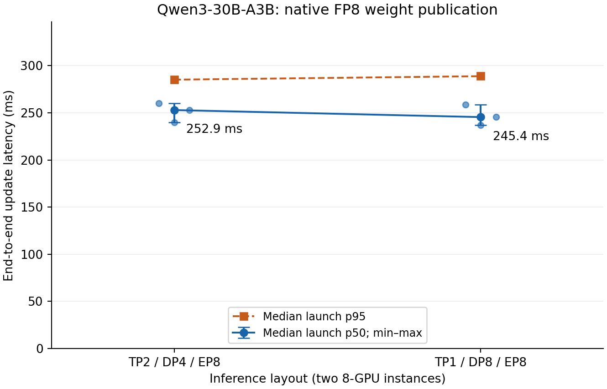

# Native FP8 replica supplement, 2026-10-20

Measured revision: `835b7f56fcc3fb26ca856b1edf7b239ab9420e56`, branch `codex/unified-replica-routing`. Complete logical replica routing, stream source selection, source-node ring ordering and NIC spread throughout. No feature-disable controls.

Training: 16 H20 GPUs, TP2/CP4/EP8/ETP1, PP1, dense/expert DP2/2, BF16 sources fused to native E4M3 FP8 by the transport kernel. Two eight-GPU inference instances, one per inference node, EP8. See the [protocol](replica-fp8-experiment.md).

**Six independent launches, five warmups plus thirty measured updates each: 210 regular updates and six separate checkpoint bootstraps fully verified, 180 steady samples.** Two qualification smoke launches, seven regular updates and one bootstrap each, are excluded from formal statistics.

Values are the median of three launch p50s, with their full min–max range. p95 is the median of three launch p95s. Individual launch values remain in the CSV.

| Inference TP / DP / EP | p50, min–max (ms) | p95 (ms) |
|---|---:|---:|
| 1 / 8 / 8 | 245.427 [236.696–258.867] | 288.797 |
| 2 / 4 / 8 | 252.875 [239.738–260.192] | 285.110 |

Training injects 31.184 GB of wire payload per update, covering 61.064 GB of unique logical BF16 source parameters (48.9% fewer bytes). This includes FP8 tile headers and unquantized parameters; it is distinct from total NIC traffic. The two source nodes inject 15.903/15.281 GB (4.1% max/min spread): logical BF16 balancing does not exactly balance mixed FP8 wire bytes.

Every update clears destination weights and scales outside the timer. Every inference worker checks complete native FP8 bytes exactly against independently quantized safetensors checkpoint slices, FP32 scales against independent block amax references (rtol 5e−7, atol 0), and remaining BF16/FP32 parameters exactly. Version markers, stable pointers, restored-checkpoint generation, native plan reuse, FP8 spans, source-coverage reconstruction, GPU/HCA affinity and node-contiguous acyclic routing are checked. The bootstrap populates dummy FP8 storage before the generation baseline.

**Training TP/CP differs from the preceding [BF16 matrix](replica-scaling-results-20261020.md): TP2/CP4 versus TP4/CP2. The FP8 benchmark also explicitly drains/pauses generation scheduling. Comparisons describe complete configurations, not a precision-only ablation.** These two layouts establish no universal FP8 TP4+ support restriction.

Before the scheduler lifecycle fix, DP8 smoke and an initial formal attempt hung after generation. Python stacks located vLLM DP dummy-batch coordination interleaving with update RPCs. The frozen formal source drains/pauses all instances with /pause?mode=wait after the baseline and resumes before final generation, requiring both acknowledgements outside publication timing. DP/EP and all transport features stay enabled. All earlier outcomes and debug records are preserved separately.

All four nodes passed 258 CPU tests each. Final audit found all 32 GPUs free and scoped NCCL SHM cleanup complete. Full evidence, 24 formal plus eight qualification smoke node archives and sixteen pre-fix node archives, publication/rank/NIC data, source bundles and SHA256 manifests are in local `results/shardstream-replica-fp8-20261020` and head `/mnt/fuse/verl-e2e/runs/shardstream-replica-fp8-20261020`. The personal OSS probe returned EIO; no OSS backup is claimed.
