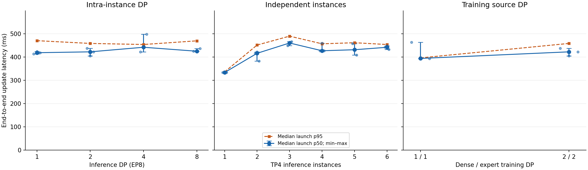

# Replica scaling: Qwen3-30B-A3B BF16, 2026-10-20

Measured revision: `7507911d1f7ca382555f36ddff3c16dc4ea9d651`, branch `codex/unified-replica-routing`. Four 8-GPU H20-3e nodes.

The subsequent [native FP8 supplement](replica-fp8-results-20261020.md) covers TP2/DP4/EP8 and TP1/DP8/EP8 with training TP2/CP4. Its changed training topology and explicit generation pause make it a complete-configuration comparison rather than a precision-only ablation.

The complete logical routing, stream source selection, source-node ring order, and NIC spread scheme was enabled throughout. No feature-disable controls were run. See the [protocol](replica-scaling-experiment.md) for all layouts and placement rules.

**33 independent launches across 11 unique configurations; 5 warmups and 30 measured publications per launch. All 1,155 publications passed full-parameter checks on every inference worker; 990 steady samples.** Training DP2 uses the identical intra-DP2 launches. No prior experiment measurements were reused.

Latency below is the median of three launch p50s. Brackets give the full range of launch p50s; p95 is the median of three launch p95s.

## Inference intra-instance DP

| Case | p50, min–max (ms) | p95 (ms) |
|---|---:|---:|
| intra-dp1 | 419.0 [413.6–424.4] | 470.8 |
| intra-dp2 | 422.7 [405.2–438.3] | 458.9 |
| intra-dp4 | 442.4 [422.6–498.5] | 454.3 |
| intra-dp8 | 425.4 [425.2–437.1] | 470.1 |

## Independent TP4 inference instances

| Case | p50, min–max (ms) | p95 (ms) |
|---|---:|---:|
| inter-r1 | 333.7 [333.7–333.8] | 336.3 |
| inter-r2 | 416.4 [383.3–422.4] | 452.0 |
| inter-r3 | 460.8 [449.2–466.7] | 490.3 |
| inter-r4 | 427.4 [427.2–460.3] | 457.3 |
| inter-r5 | 431.8 [408.9–458.0] | 461.9 |
| inter-r6 | 442.3 [432.6–448.8] | 454.2 |

## Training dense/expert DP

| Case | p50, min–max (ms) | p95 (ms) |
|---|---:|---:|
| sender-dp1 | 394.4 [394.0–463.9] | 396.7 |
| intra-dp2 | 422.7 [405.2–438.3] | 458.9 |

## Findings and limits

- Intra-instance DP1–8 configuration medians span 5.6% (max/min−1).
- The single-instance baseline is consistently faster than multiple instances. The full 1–6 instance curve is not flat. Active inference hosts increase from one to two to three at its first three points; host order rotates across launches.
- Training DP1/1→2/2 increases the measured p50 by 7.2%. The halved per-source load does not yield a latency improvement in this experiment.
- Total training source payload stays at 61.064 GB for every layout. Per training node it drops from 61.064 to 30.532 GB with two source nodes. Three inference ingress nodes receive approximately 19.291/20.695/21.078 GB (9.3% max/min spread), so ingress balancing is not exact.
- The single-to-multiple-instance increase is also present in measured GPU kernel durations. These profiles do not establish which feature causes the increase. Only three launches per configuration were run, with no feature-disable controls.
- Every TP4 instance was checked against actual pre-NCCL GPU/HCA records and covered four NICs. With two colocated TP4 instances, some GPU/NIC PCIe distances and NCCL LSA team boundaries change; not every same-node hop is necessarily NVLink.
- All four nodes passed 244 CPU tests each. Final audit confirmed all 32 GPUs free and scoped shared-memory cleanup complete.

The full evidence, 132 formal node-log archives, runtime inventory, commands, per-publication/rank/NIC data, report, and SHA256 manifest are stored in `results/shardstream-replica-scaling-20261020` in the local workspace and `/mnt/fuse/verl-e2e/runs/shardstream-replica-scaling-20261020` on the selected head. The personal OSS write probe returned EIO; no OSS backup is claimed.

The committed CSVs retain each launch separately. The figure uses launch p50 medians, full min–max bars, individual launch points, and median launch p95s. The original implementation bundle preserves the exact measured source revision.
